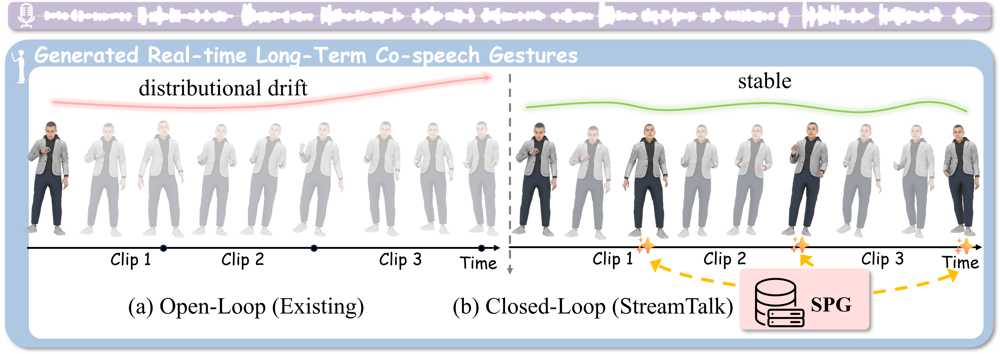
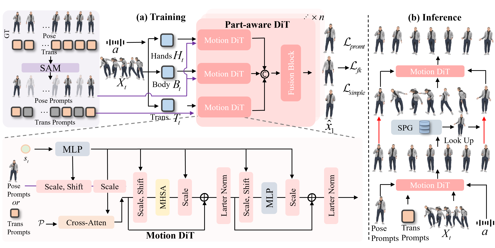
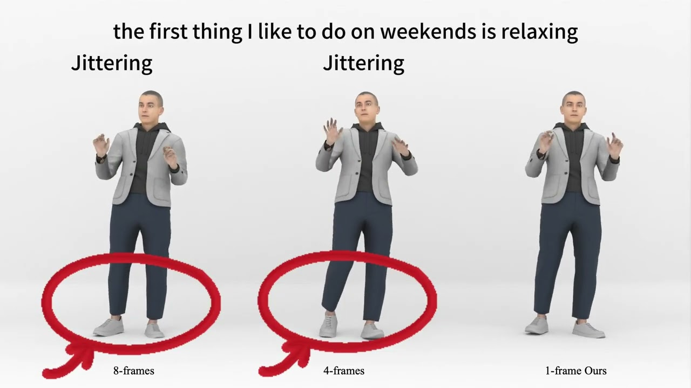

<h1 align="center">StreamTalk: Streaming Co-Speech Gesture Generation with Key-Pose Anchoring</h1>

<p align="center">
  <a href="https://www.xiangyuezhang.com/">Xiangyue Zhang</a><sup>1,2,*</sup> ·
  <a href="https://github.com/Xiangyue-Zhang/StreamTalk">Jianfang Li</a><sup>2,*</sup> ·
  <a href="https://kebii.github.io/">Jiaxu Zhang</a><sup>3</sup> ·
  <a href="https://sun-happy-ykx.github.io/yangkaixing.github.io/">Kaixing Yang</a><sup>4</sup> ·
  <a href="https://sites.google.com/view/stevenhoi/home">Steven Hoi</a><sup>2</sup>
</p>

<p align="center">
  <sup>1</sup>The University of Tokyo &nbsp;·&nbsp;
  <sup>2</sup>Tongyi Lab, Alibaba Group &nbsp;·&nbsp;
  <sup>3</sup>Nanyang Technological University &nbsp;·&nbsp;
  <sup>4</sup>Renmin University
</p>

<p align="center"><sup>*</sup> Equal contribution</p>

<h3 align="center">✨ ECCV 2026 ✨</h3>

<p align="center">
  <a href="https://arxiv.org/abs/2608.01643"></a>
  <a href="https://xiangyuezhang.com/StreamTalk/"></a>
  <a href="https://youtu.be/tKV3lWD6MDI"></a>
  <a href="LICENSE"></a>
</p>

<p align="center"><strong>Closed-loop, real-time co-speech gesture generation that remains stable over long horizons.</strong></p>

<p align="center">
  
</p>

<p align="center"><sub>StreamTalk periodically retrieves a plausible destination pose and refines each generated window before it becomes context for the next one.</sub></p>

## 📣 News

- **[2026-08]** Training and inference code are released.

## 💖 Inference Data

To compare against StreamTalk without reproducing the full WavLM, retrieval, and SMPL-X generation pipeline, download our generated BEAT2 test outputs directly. This follows the convenient inference-data release style used by [SemTalk](https://github.com/Xiangyue-Zhang/SemTalk).

| Evaluation split | Download |
| :-- | :-- |
| Speaker 2 (Scott) | [Download generated `.npz` files](https://huggingface.co/datasets/X-Zhang/StreamTalk-Inference-Data/resolve/main/streamtalk_speaker2_e0946_cfg3_npz.tar.gz) |
| All speakers | [Download generated `.npz` files](https://huggingface.co/datasets/X-Zhang/StreamTalk-Inference-Data/resolve/main/streamtalk_all_e0940_cfg3_npz.tar.gz) |

The files are generated SMPL-X sequences named `res_<BEAT2-test-id>.npz`. Each file contains `poses`, `trans`, `expressions`, `betas`, `gender`, `mocap_frame_rate`, and `model`. They are predictions for metric comparison and visualization, not ground-truth data. The [dataset repository](https://huggingface.co/datasets/X-Zhang/StreamTalk-Inference-Data) contains the archive manifests and checksums.

## 🧠 Pretrained Models

The release provides two checkpoint files:

| Intended use | Download |
| :-- | :-- |
| Speaker 2 and combined selection | [`streamtalk_speaker2_combined_e0946_cfg3.pt`](https://huggingface.co/X-Zhang/StreamTalk/resolve/main/streamtalk_speaker2_combined_e0946_cfg3.pt) |
| All-speaker selection | [`streamtalk_speaker_all_e0940_cfg3.pt`](https://huggingface.co/X-Zhang/StreamTalk/resolve/main/streamtalk_speaker_all_e0940_cfg3.pt) |

Download and verify both unique files from the repository root:

```bash
pip install "huggingface_hub==0.36.0"
hf download X-Zhang/StreamTalk \
  streamtalk_speaker2_combined_e0946_cfg3.pt \
  streamtalk_speaker_all_e0940_cfg3.pt \
  --local-dir checkpoints/pretrained

python tools/verify_pretrained.py --weights-dir checkpoints/pretrained
```

## 💡 Overview

Streaming co-speech systems generate motion one short window at a time. In a conventional open-loop pipeline, small errors are passed from one window to the next and can gradually move a long sequence away from natural human motion. StreamTalk closes this loop with three components:

- **Streaming Pose-Guided Generation (SPG):** generate a coarse window, retrieve a plausible tail pose from a speaker-specific motion database, and refine the window toward that anchor.
- **Stochastic Anchor Masking (SAM):** expose the model to sparse pose and translation conditions during training so it can use boundary anchors at inference time.
- **Part-aware DiT:** model hands, body, and root translation in separate branches before fusing their features, reducing interference between local articulation and global movement.

On BEAT2, StreamTalk reaches an FGD of **0.383** in the one-speaker setting and **0.293** in the all-speaker setting. The paper reports **76 FPS** on an NVIDIA V100 16 GB GPU with the default retrieval database.

<p align="center">
  
</p>

## 🎬 Demo

<p align="center">
  <a href="https://youtu.be/tKV3lWD6MDI"></a>
  <br>
  <sub>Click the image to watch the full StreamTalk demo.</sub>
</p>

## 📊 Headline Results

| BEAT2 setting | FGD ↓ | BC → GT | DIV → GT |
| :-- | --: | --: | --: |
| 1 speaker | **0.383** | 0.704 <sub>(GT: 0.703)</sub> | 13.18 <sub>(GT: 11.97)</sub> |
| All speakers | **0.293** | 0.616 <sub>(GT: 0.477)</sub> | 7.27 <sub>(GT: 7.29)</sub> |

FGD is lower-is-better. BC and DIV are interpreted relative to the ground-truth values rather than simply maximized. See the [paper](https://arxiv.org/abs/2608.01643) for complete comparisons, ablations, and long-horizon analysis.

## ⚡ Quick Start

### 1. Clone and install

```bash
git clone https://github.com/Xiangyue-Zhang/StreamTalk.git
cd StreamTalk

conda env create -f environment.yml
conda activate pytorch20

# Additional packages imported by preprocessing and inference
pip install transformers librosa smplx positional-encodings einops tqdm matplotlib
```

The current scripts call CUDA directly, so a CUDA-capable NVIDIA GPU is required. The provided environment targets Python 3.9, PyTorch 2.0, and CUDA 11.8.

### 2. Prepare external assets

| Asset | Purpose | Configuration |
| :-- | :-- | :-- |
| [WavLM Large](https://huggingface.co/patrickvonplaten/wavlm-libri-clean-100h-large) | Audio features | Pass its Hugging Face model ID or local directory through `--wavlm_model`. |
| [BEAT2](https://huggingface.co/datasets/H-Liu1997/BEAT2) | Prompt motion and speaker-specific retrieval database | Pass `smplxflame_30`, `wave16k`, and `train_test_split.csv` through the explicit test arguments below. |
| [SMPL-X](https://smpl-x.is.tue.mpg.de/) | Forward kinematics for pose retrieval | Pass the downloaded neutral model through `--smplx_model`. |

### 3. Run the sample inference

After downloading the Speaker 2 checkpoint, run the bundled Scott example with CFG 3:

```bash
export STREAMTALK_ROOT="$(pwd)"
export PYTHONPATH="${STREAMTALK_ROOT}/Scripts:${PYTHONPATH:-}"

mkdir -p "${STREAMTALK_ROOT}/outputs"
cd "${STREAMTALK_ROOT}/Scripts/FM"

python TestFixedExpressions_keyposes.py \
  "${STREAMTALK_ROOT}/Data/Test/2_scott_0_1_1.wav" \
  "${STREAMTALK_ROOT}/checkpoints/pretrained/streamtalk_speaker2_combined_e0946_cfg3.pt" \
  --example_motion_npz "${STREAMTALK_ROOT}/Data/Test/2_scott_0_1_1.npz" \
  --pid 2_scott_0 \
  --output_file "${STREAMTALK_ROOT}/outputs/streamtalk_demo.npz" \
  --wavlm_model patrickvonplaten/wavlm-libri-clean-100h-large \
  --smplx_model /absolute/path/to/SMPLX_NEUTRAL_2020.npz \
  --retrieval_data_folder /absolute/path/to/beat_english_v2.0.0/smplxflame_30 \
  --retrieval_csv_file /absolute/path/to/beat_english_v2.0.0/train_test_split.csv \
  --cfg_scale 3 \
  --seed 0
```

The output is an SMPL-X parameter sequence in `.npz` format. The explicit asset arguments avoid machine-specific paths; `--cfg_scale 1` preserves the original unguided forward path exactly.

## 🗂️ Data Preparation

Download the official [BEAT2 dataset from Hugging Face](https://huggingface.co/datasets/H-Liu1997/BEAT2). StreamTalk uses the English release:

```bash
pip install "huggingface_hub==0.36.0"

hf download H-Liu1997/BEAT2 \
  --repo-type dataset \
  --include "beat_english_v2.0.0/**" \
  --local-dir Data/BEAT2

export BEAT2_ROOT="$(pwd)/Data/BEAT2/beat_english_v2.0.0"
```

The downloaded directory should contain:

```text
beat_english_v2.0.0/
├── smplxflame_30/
├── wave16k/
├── sem/
└── train_test_split.csv
```

Generate the 60-frame HDF5 training windows from the repository root:

```bash
python Data/BEAT2/create_h5.py \
  --data_folder "${BEAT2_ROOT}" \
  --h5_path Data/BEAT2/train_seq_size_60_stride_size_20_global.h5 \
  --seq_size 60 \
  --stride_size 20 \
  --split train \
  --local_rotation 0 \
  --huberts 1 \
  --wavlm_model patrickvonplaten/wavlm-libri-clean-100h-large
```

Feature extraction can take roughly an hour on the original setup; actual time depends on storage and GPU throughput.

## 🚀 Training

The released trainer uses PyTorch Distributed Data Parallel. The paper reports training on four NVIDIA V100 16 GB GPUs; change `--nproc_per_node` to the number of GPUs available on your machine.

```bash
export STREAMTALK_ROOT="$(pwd)"
export PYTHONPATH="${STREAMTALK_ROOT}/Scripts:${PYTHONPATH:-}"
cd "${STREAMTALK_ROOT}/Scripts/FM"

torchrun --standalone --nproc_per_node=4 \
  TrainFixedExpressionsTrans_backup.py \
  --h5_path "${STREAMTALK_ROOT}/Data/BEAT2/train_seq_size_60_stride_size_20_global.h5" \
  --ckpt_folder "${STREAMTALK_ROOT}/checkpoints/streamtalk"
```

Useful options include `--batch_size`, `--epoch`, `--lr`, `--save_n_epoch`, and `--resume`. `--batch_size` is applied per process; the current masking implementation requires each local batch to be at least 32 and divisible by 8. Checkpoints are written to the directory passed through `--ckpt_folder`.

## 🧪 Test-Set Generation and FGD

`TestFixedExpressions_keyposes_all.py` runs the single-sequence StreamTalk inference path over an exact BEAT2 split. Run it from the repository root after setting `PYTHONPATH`:

```bash
export STREAMTALK_ROOT="$(pwd)"
export PYTHONPATH="${STREAMTALK_ROOT}/Scripts:${PYTHONPATH:-}"
export BEAT2_ROOT=/absolute/path/to/beat_english_v2.0.0
export SMPLX_MODEL=/absolute/path/to/SMPLX_NEUTRAL_2020.npz
export WAVLM_MODEL=patrickvonplaten/wavlm-libri-clean-100h-large

# Speaker 2 (Scott): 15 test clips, epoch 946, CFG 3
python Scripts/FM/TestFixedExpressions_keyposes_all.py \
  --data_folder "${BEAT2_ROOT}/smplxflame_30" \
  --wav_folder "${BEAT2_ROOT}/wave16k" \
  --csv_file "${BEAT2_ROOT}/train_test_split.csv" \
  --checkpoint checkpoints/pretrained/streamtalk_speaker2_combined_e0946_cfg3.pt \
  --output_folder outputs/speaker2_e0946_cfg3 \
  --wavlm_model "${WAVLM_MODEL}" \
  --smplx_model "${SMPLX_MODEL}" \
  --pid 2_scott_0 \
  --cfg_scale 3 \
  --seed 0

# All speakers: 265 test clips, epoch 940, CFG 3
python Scripts/FM/TestFixedExpressions_keyposes_all.py \
  --data_folder "${BEAT2_ROOT}/smplxflame_30" \
  --wav_folder "${BEAT2_ROOT}/wave16k" \
  --csv_file "${BEAT2_ROOT}/train_test_split.csv" \
  --checkpoint checkpoints/pretrained/streamtalk_speaker_all_e0940_cfg3.pt \
  --output_folder outputs/all_e0940_cfg3 \
  --wavlm_model "${WAVLM_MODEL}" \
  --smplx_model "${SMPLX_MODEL}" \
  --cfg_scale 3 \
  --seed 0
```

Add `--dry_run` to inspect every generated command without loading a model, or `--limit N` for a small end-to-end smoke test. Each sequence resets the requested seed, matching the release selection setup.

Score generated outputs with the vendored EMAGE/PantoMatrix AESK encoder and the pinned official BEAT2 test IDs:

```bash
# Speaker 2: reproduce the published accelerated NPZ re-score
python tools/evaluate_generated_fgd.py \
  --predictions outputs/speaker2_e0946_cfg3 \
  --ground_truth "${BEAT2_ROOT}/smplxflame_30" \
  --scope speaker2 \
  --device cuda:0 \
  --metric_batch_size 16 \
  --output outputs/speaker2_e0946_cfg3/fgd.json

# All speakers: accelerated equal-length metric batching
python tools/evaluate_generated_fgd.py \
  --predictions outputs/all_e0940_cfg3 \
  --ground_truth "${BEAT2_ROOT}/smplxflame_30" \
  --scope all \
  --device cuda:0 \
  --metric_batch_size 16 \
  --output outputs/all_e0940_cfg3/fgd.json
```

If you downloaded the [Inference Data](#-inference-data), skip generation and point `--predictions` at the extracted directory containing the `res_*.npz` files. The scorer validates the exact 15/265-file fixture, truncates each clip independently to the AESK temporal multiple, pins the encoder checksum, and writes the full metric contract beside the FGD value.

Use `--metric_batch_size 1` when you specifically want the slower conservative per-clip AESK path. The published Inference Data re-scores use equal-length metric batching with batch size 16, which is substantially faster and stayed within the selected `1e-3` engineering tolerance in the release checks.

## 🔎 Inference Notes

Before inference, verify the following:

1. `--wavlm_model` resolves to WavLM Large or a compatible local snapshot.
2. `--smplx_model` resolves to the neutral SMPL-X model.
3. `--retrieval_data_folder` and `--retrieval_csv_file` point to BEAT2's `smplxflame_30` folder and `train_test_split.csv`.
4. `--pid` matches the speaker prefix used to build the retrieval database.
5. The supplied generator checkpoint matches `DiffusionDITNetPartsFixedExpressions2PostNormInteraction2` in `Scripts/FM/Net.py`.

The inference script builds its retrieval database from the configured BEAT2 training files, then performs the generate–retrieve–refine loop for every streaming window.

## 📺 Visualization

The generated `.npz` files store SMPL-X parameters at 30 FPS. To render them, download the [BEAT2 SMPL-X Blender add-on](https://huggingface.co/datasets/H-Liu1997/BEAT2_Tools/blob/main/smplx_blender_addon_20230921.zip), install it in Blender 3.x or 4.x, and use **Add Animation** to import the output sequence.

## 🧭 Repository Layout

```text
StreamTalk/
├── Data/
│   ├── BEAT2/create_h5.py                 # BEAT2 preprocessing
│   └── Test/                              # Bundled sample audio and motion
├── Scripts/
│   ├── Common/                            # Dataset, SMPL-X, FK, and rotation utilities
│   └── FM/
│       ├── EMAGE_VAE/                      # Vendored AESK FGD encoder and pinned asset
│       ├── Net.py                         # Part-aware motion model
│       ├── FindNearest.py                 # Speaker-specific pose retrieval
│       ├── TrainFixedExpressionsTrans_backup.py
│       ├── TestFixedExpressions_keyposes.py
│       └── TestFixedExpressions_keyposes_all.py
├── checkpoints/pretrained/                  # Release manifest, checksums, downloaded weights
├── resources/                             # README figures
├── tests/                                 # Dependency-light release and CFG checks
├── tools/
│   ├── assets/official_beat2_test_ids.json
│   ├── evaluate_generated_fgd.py      # Reproducible Speaker 2/all-speaker scorer
│   └── verify_pretrained.py           # Size and SHA-256 verification
├── environment.yml
├── LICENSE
└── README.md
```

## 🙏 Acknowledgments

StreamTalk builds on resources from [BEAT2](https://huggingface.co/datasets/H-Liu1997/BEAT2), [WavLM](https://huggingface.co/patrickvonplaten/wavlm-libri-clean-100h-large), and [SMPL-X](https://smpl-x.is.tue.mpg.de/). We thank their authors for making these assets available to the research community.

## 📖 Citation

If you find StreamTalk useful, please consider citing:

```bibtex
@inproceedings{zhang2026streamtalk,
  title={StreamTalk: Streaming Co-Speech Gesture Generation with Key-Pose Anchoring},
  author={Zhang, Xiangyue and Li, Jianfang and Zhang, Jiaxu and Yang, Kaixing and Hoi, Steven},
  booktitle={European Conference on Computer Vision},
  year={2026},
  eprint={2608.01643},
  archivePrefix={arXiv},
  primaryClass={cs.CV},
  url={https://arxiv.org/abs/2608.01643}
}
```

## 📄 License

The repository code is released under the [MIT License](LICENSE). Third-party datasets, pretrained models, and related assets remain subject to their respective licenses and terms of use.
